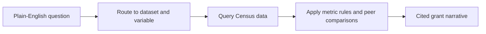
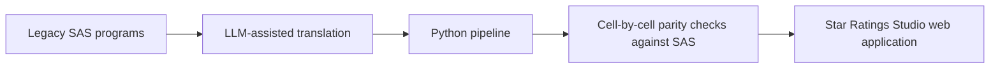

<h1 align="center">Grace Petrov</h1>

  

  
  
  

---

I build 0-to-1 data products and full-stack decision models that convert entrenched business problems into measured strategy and impact. I work across business functions to align technical solution architecture with strategic priorities and execution.

I am a BBA candidate at Emory University's Goizueta Business School, concentrating in Information Systems and Artificial Intelligence, and an AI Research Fellow at Emory's Center for AI Learning. My background includes client-facing engagements under compressed timelines with nonprofit and Fortune 500 organizations, where I have applied data analysis, machine learning, market research, and financial modeling to strategy, operations, customer insights, and technology implementation. More recently, I have expanded from analysis into building software and data products that make complex information accessible and actionable.

## Impact at a Glance

<table>
  <tr>
    <td align="center" width="25%"><h3>4,566</h3>hospitals validated against SAS in a CMS star-rating migration</td>
    <td align="center" width="25%"><h3>1e-12</h3>maximum difference between Python and SAS outputs</td>
    <td align="center" width="25%"><h3>24,711</h3>flights in the held-out test set for an airline forecasting model</td>
    <td align="center" width="25%"><h3>3</h3>data products built across nonprofit, public health, and airline operations</td>
  </tr>
</table>

## Selected Work

Select any project to expand the full business case, solution, and contributions.

<b>Grant Copilot</b> &nbsp;|&nbsp; AI writing assistant that grounds nonprofit grant applications in verified Census data

 

*Emory University Capstone, 2026. Top contributor.*

**Business Problem**

Competitive grant applications depend on quantitative evidence of community need. The most comprehensive source of that evidence, U.S. Census data, spans thousands of variables, geographies, and annual releases. Most small nonprofits do not have dedicated analysts, so their applications often omit supporting data or cite figures that cannot be traced to a source. Both outcomes reduce an application's credibility with funders.

**Solution**

Grant Copilot allows a grant writer to ask a question in plain English, such as *"I am writing a food pantry grant for Southwest Atlanta,"* and receive a cited narrative of relevant statistics, trends, and peer comparisons. Each figure is traceable to a specific Census variable, year, and geography, which allows the writer to substantiate every claim.

**Key Contributions**
- Developed peer-matching logic that remains accurate across Census releases and added support for multi-year queries
- Implemented session-aware follow-up questions and redesigned the response and loading interfaces for non-technical users
- Strengthened the evidence and export pipeline to keep every exported figure consistent with its original source

`Python` `Gemini / Vertex AI` `FAISS` `SpatiaLite` `Census ACS` `Docker`

*Private repository. Demo available upon request.*

<b>AI-Powered SAS to Python Migration</b> &nbsp;|&nbsp; LLM-assisted modernization of the CMS hospital star-rating pipeline, with Abt Global

 

*In partnership with Abt Global, Fall 2026.* &nbsp; [View the Star Ratings Studio application](https://github.com/gpetrov2024/Abt-Global-1B-ai-powered-sas-migration/tree/star-ratings-ui/app)

**Business Problem**

Public agencies such as the Centers for Medicare & Medicaid Services continue to run critical analytics on SAS, a platform with high licensing costs and a shrinking talent pool. Manual migration to Python is slow and error-prone. Each program must be translated, tested, and documented, and institutional knowledge embedded in legacy code is frequently lost in the process.

**Solution**

An LLM-assisted workflow that translates SAS programs into Python, verifies that outputs match, flags discrepancies, and documents the underlying business logic. The system is evaluated against the production pipeline behind the CMS Overall Hospital Quality Star Ratings, a public rating that patients use to compare hospitals.

**Key Contributions**
- **Translated and validated Program 1**, which produces first-stage group scores across all five hospital measure groups. Every column of every output table was compared cell by cell against the original SAS datasets for 4,566 hospitals, with all results matching within 1e-12. The translation preserves SAS arithmetic and missing-value handling to guarantee exact parity with the original outputs.
- **Built the end-to-end pipeline runner**, which executes Programs 0 through 2 in sequence and reuses each program's validated functions to maintain a single source of truth.
- **Designed and developed Star Ratings Studio**, the team's web application, which gives analysts full access to the migrated pipeline through a graphical interface.
  - **Run and compare.** Users can run the pipeline on reference data or a newly uploaded measure file, save results, and compare two runs side by side to identify every hospital whose rating changed.
  - **Explore.** A ratings dashboard presents a state-level map, rating distributions, and peer groups, along with a searchable hospital directory and detail pages that show how each group score contributes to the final star rating.
  - **Validate.** A SAS parity page checks all nine output tables against the original SAS results, a methodology page maps each stage to the SAS program it replaces, and a printable report summarizes each run.
  - **Reproduce.** Every run can be exported with a manifest that records the input file fingerprint, pipeline version, package versions, processing times, and validation results.
  - **Deploy.** The application is packaged as a single Docker image, with continuous integration that runs the full test suite on every pull request.

`Python` `pandas` `FastAPI` `React` `TypeScript` `Tailwind` `pytest` `datacompy` `Docker` `GitHub Actions`

<b>Baggage Volume Prediction for American Airlines</b> &nbsp;|&nbsp; Neural network that forecasts checked bags per flight to inform ground-crew staffing

 

[View the repository](https://github.com/gpetrov2024/AmericanAirlines_BaggageOperations)

**Business Problem**

Airlines plan ground crew and baggage-handling staffing around the expected number of checked bags per flight. Underestimates lead to delayed or mishandled baggage, which affects on-time performance and customer satisfaction. Overestimates result in excess labor costs.

**Solution**

A neural network that forecasts checked-bag volume for each flight using flight and schedule attributes, giving operations teams a more accurate basis for staffing decisions.

**Key Contributions**
- Built a feed-forward neural network with learned embeddings for categorical flight attributes such as aircraft type and route
- Evaluated 288 hyperparameter configurations using early stopping and tested the best-performing model on 24,711 held-out flights

`PyTorch` `pandas` `Parquet` `SQL`

## Technical Skills

  
  
  
  
  
  
  
  
  
  
  
  

View the full skills inventory

 

| | |
|---|---|
| **Languages and Data** | Python, SQL, TypeScript, pandas, NumPy, DuckDB, SQLite, Parquet |
| **Machine Learning and NLP** | PyTorch, scikit-learn, spaCy, NLTK |
| **Generative AI and Retrieval** | OpenAI and Gemini APIs, RAG, embeddings, FAISS |
| **Applications and Cloud** | FastAPI, React, Google Cloud, Vertex AI, Docker, GitHub Actions, REST APIs |
| **Analytics and Business** | Tableau, Plotly, Matplotlib, Excel financial modeling, market research |

