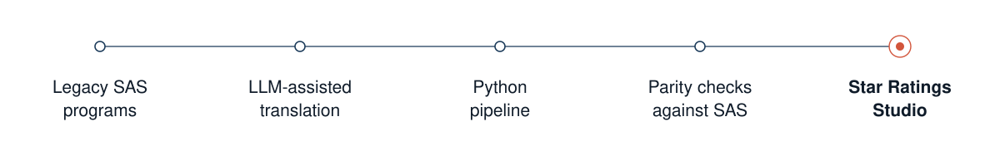
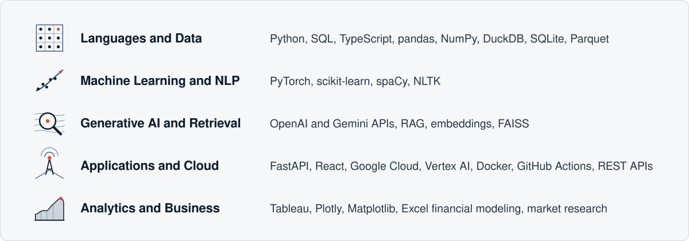

<picture>
  <source media="(max-width: 600px) and (prefers-color-scheme: dark)" srcset="assets/banner-mobile-dark.svg" />
  <source media="(max-width: 600px)" srcset="assets/banner-mobile-light.svg" />
  <source media="(prefers-color-scheme: dark)" srcset="assets/banner-dark.svg" />
  
</picture>

  <a href="https://www.linkedin.com/in/gracepetrov/">LinkedIn</a>&emsp;&emsp;<a href="mailto:gpetrov2024@gmail.com">gpetrov2024@gmail.com</a>&emsp;&emsp;Atlanta,&nbsp;GA

I build 0-to-1 data products and full-stack decision models that convert entrenched business problems into measured strategy and impact. I am a BBA candidate at Emory University's Goizueta Business School and an AI Research Fellow at Emory's Center for AI Learning, with client-facing experience across nonprofit and Fortune 500 engagements.

## Selected Work

<a href="#grant-copilot"><picture>
  <source media="(max-width: 600px) and (prefers-color-scheme: dark)" srcset="assets/row-grant-copilot-mobile-dark.svg" />
  <source media="(max-width: 600px)" srcset="assets/row-grant-copilot-mobile-light.svg" />
  <source media="(prefers-color-scheme: dark)" srcset="assets/row-grant-copilot-dark.svg" />
  
</picture></a>
<a href="https://github.com/gpetrov2024/Abt-Global-1B-ai-powered-sas-migration/tree/star-ratings-ui/app"><picture>
  <source media="(max-width: 600px) and (prefers-color-scheme: dark)" srcset="assets/row-sas-migration-mobile-dark.svg" />
  <source media="(max-width: 600px)" srcset="assets/row-sas-migration-mobile-light.svg" />
  <source media="(prefers-color-scheme: dark)" srcset="assets/row-sas-migration-dark.svg" />
  
</picture></a>
<a href="https://github.com/gpetrov2024/AmericanAirlines_BaggageOperations"><picture>
  <source media="(max-width: 600px) and (prefers-color-scheme: dark)" srcset="assets/row-baggage-forecasting-mobile-dark.svg" />
  <source media="(max-width: 600px)" srcset="assets/row-baggage-forecasting-mobile-light.svg" />
  <source media="(prefers-color-scheme: dark)" srcset="assets/row-baggage-forecasting-dark.svg" />
  
</picture></a>

## Case Studies

<picture>
  <source media="(max-width: 600px) and (prefers-color-scheme: dark)" srcset="assets/sheet-grant-mobile-dark.svg" />
  <source media="(max-width: 600px)" srcset="assets/sheet-grant-mobile-light.svg" />
  <source media="(prefers-color-scheme: dark)" srcset="assets/sheet-grant-dark.svg" />
  
</picture>

<a href="https://github.com/gpetrov2024/Abt-Global-1B-ai-powered-sas-migration/tree/star-ratings-ui/app"><picture>
  <source media="(max-width: 600px) and (prefers-color-scheme: dark)" srcset="assets/sheet-sas-mobile-dark.svg" />
  <source media="(max-width: 600px)" srcset="assets/sheet-sas-mobile-light.svg" />
  <source media="(prefers-color-scheme: dark)" srcset="assets/sheet-sas-dark.svg" />
  
</picture></a>

[View the Star Ratings Studio application](https://github.com/gpetrov2024/Abt-Global-1B-ai-powered-sas-migration/tree/star-ratings-ui/app)

<picture>
  <source media="(max-width: 600px) and (prefers-color-scheme: dark)" srcset="assets/flow-sas-mobile-dark.svg" />
  <source media="(max-width: 600px)" srcset="assets/flow-sas-mobile-light.svg" />
  <source media="(prefers-color-scheme: dark)" srcset="assets/flow-sas-dark.svg" />
  
</picture>

<b>Star Ratings Studio</b> &nbsp;|&nbsp; Web application features

 

Star Ratings Studio gives analysts full access to the migrated pipeline through a graphical interface.

- **Run and compare.** Users can run the pipeline on reference data or a newly uploaded measure file, save results, and compare two runs side by side to identify every hospital whose rating changed.
- **Explore.** A ratings dashboard presents a state-level map, rating distributions, and peer groups, along with a searchable hospital directory and detail pages that show how each group score contributes to the final star rating.
- **Validate.** A SAS parity page checks all nine output tables against the original SAS results, a methodology page maps each stage to the SAS program it replaces, and a printable report summarizes each run.
- **Reproduce.** Every run can be exported with a manifest that records the input file fingerprint, pipeline version, package versions, processing times, and validation results.
- **Deploy.** The application is packaged as a single Docker image, with continuous integration that runs the full test suite on every pull request.

<a href="https://github.com/gpetrov2024/AmericanAirlines_BaggageOperations"><picture>
  <source media="(max-width: 600px) and (prefers-color-scheme: dark)" srcset="assets/sheet-baggage-mobile-dark.svg" />
  <source media="(max-width: 600px)" srcset="assets/sheet-baggage-mobile-light.svg" />
  <source media="(prefers-color-scheme: dark)" srcset="assets/sheet-baggage-dark.svg" />
  
</picture></a>

[View the repository](https://github.com/gpetrov2024/AmericanAirlines_BaggageOperations)

## Technical Skills

<picture>
  <source media="(max-width: 600px) and (prefers-color-scheme: dark)" srcset="assets/plate-skills-mobile-dark.svg" />
  <source media="(max-width: 600px)" srcset="assets/plate-skills-mobile-light.svg" />
  <source media="(prefers-color-scheme: dark)" srcset="assets/plate-skills-dark.svg" />
  
</picture>
